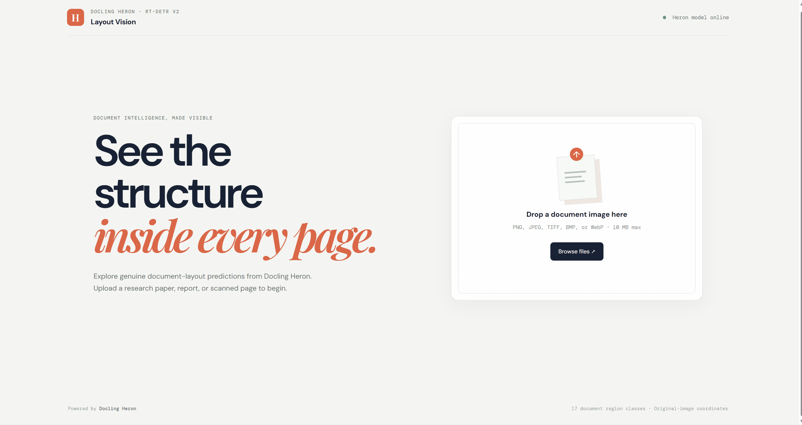
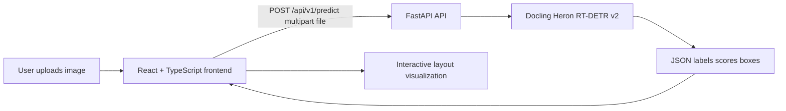
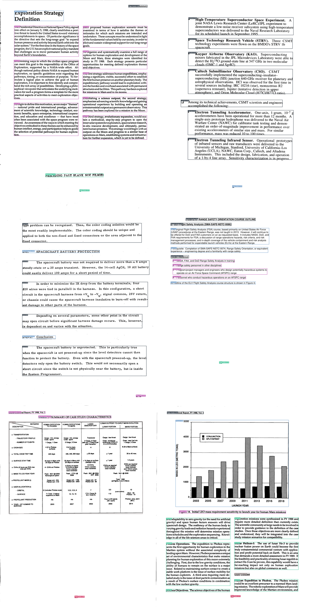
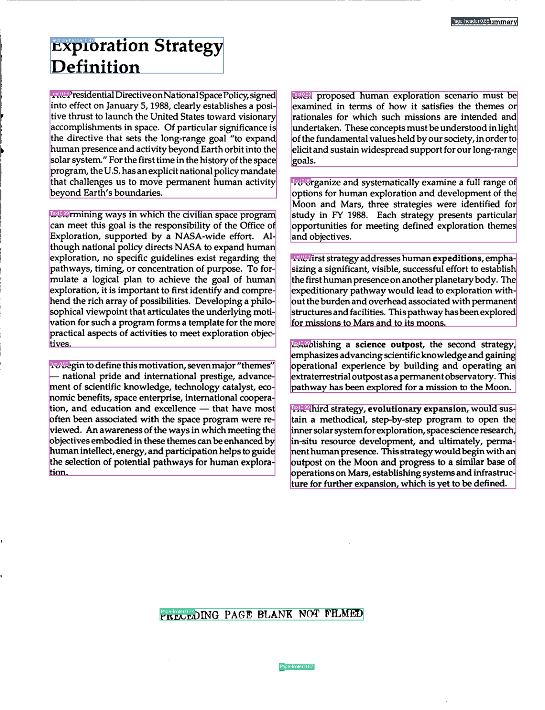
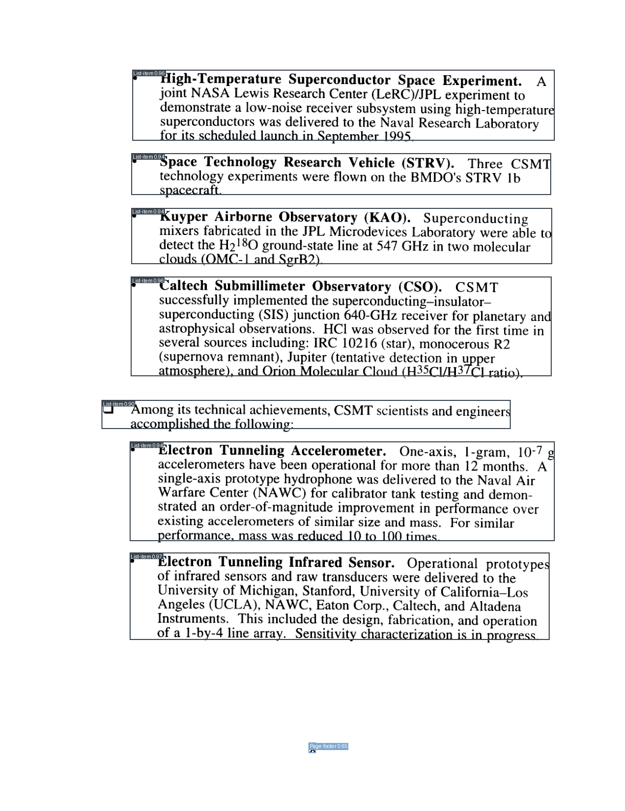
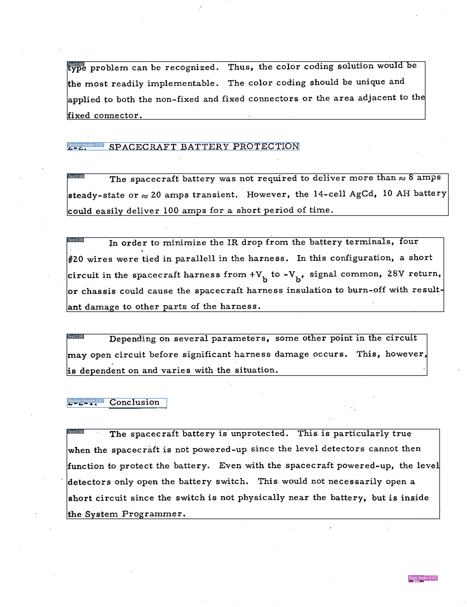
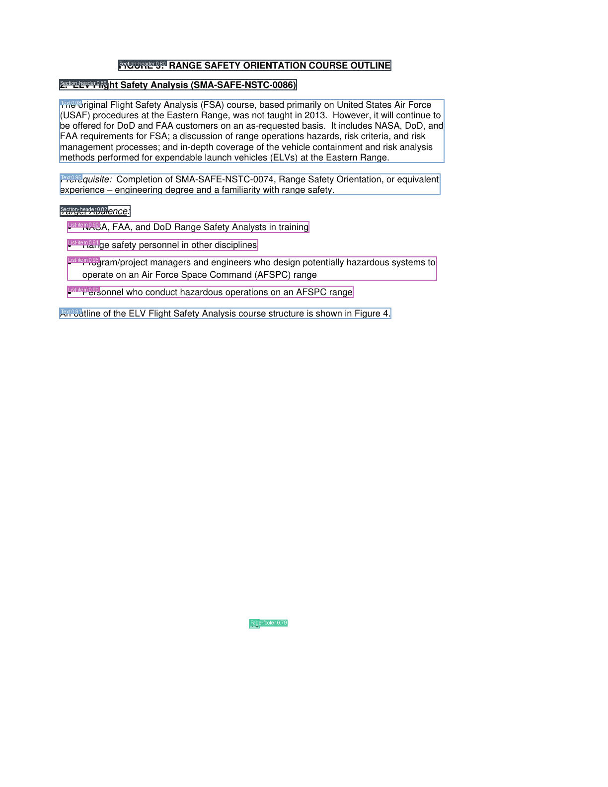
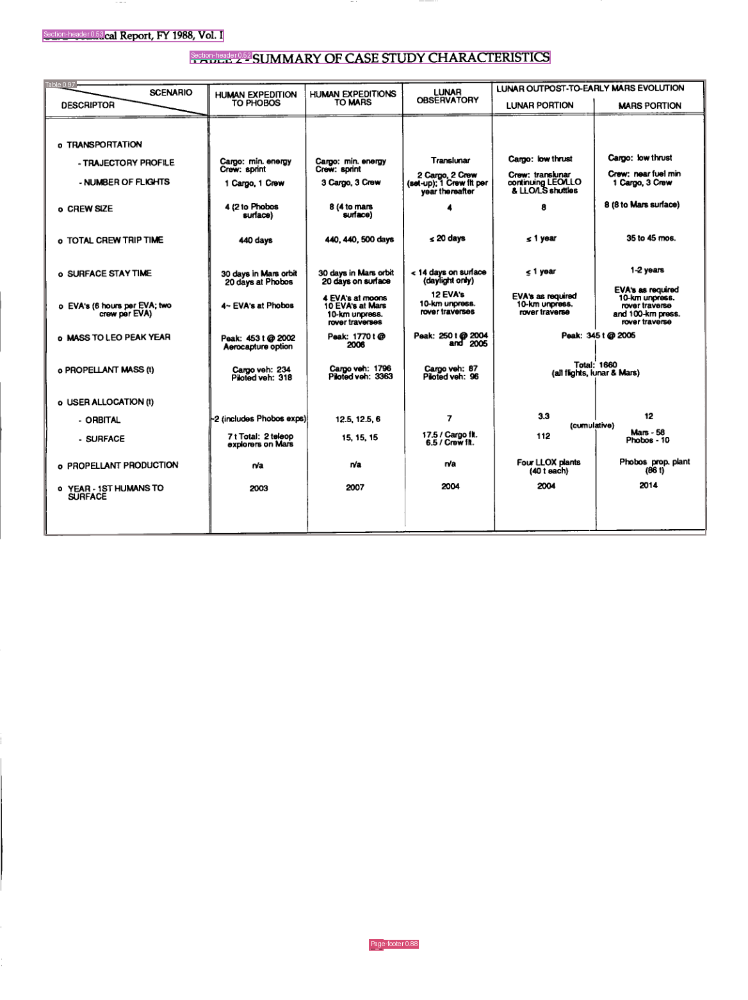
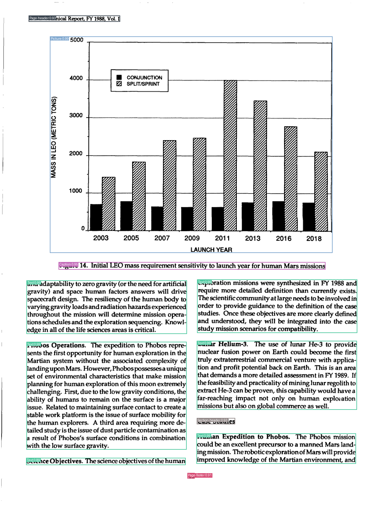

# Layout Vision

Layout Vision is a document-layout detection portfolio project that turns a
page image into an interactive visual map of its structure. It identifies
regions such as headings, paragraphs, tables, figures, captions, and page
headers, then returns their labels, confidence scores, and original-image
bounding boxes through a FastAPI service.

The project combines a React + TypeScript visualization with real inference
from the Docling Heron model. It demonstrates model integration, API design,
input validation, responsive coordinate-aware visualization, testing, Docker
packaging, and qualitative evaluation on real document pages.




## What does it do?

Documents are made of different visual regions: titles, section headings,
paragraphs, lists, tables, figures, captions, formulas, and page furniture.
Layout Vision locates those regions and draws boxes around them so that the
page structure can be inspected before downstream processing.

This type of layout signal can support applications such as:

- document digitization and preprocessing;
- organizing scanned reports and research papers;
- preparing pages for downstream OCR or information extraction;
- document-search and document-understanding pipelines.

Layout detection is not OCR. This project identifies where regions are and
what layout class they resemble; it does not read all document text, perform
full text extraction, or extract individual table cells.

## User experience

The frontend is a separate React + TypeScript + Vite application under
[`frontend/`](frontend/). The current workflow is:

1. Upload a supported document image by browsing or dragging it into the
   upload area.
2. Submit the image to the real `POST /api/v1/predict` endpoint.
3. View the original page with responsive Heron bounding-box overlays.
4. Inspect predicted labels, confidence scores, coordinates, region counts,
   distinct labels, and inference time.
5. Filter detections by label, select a result or box to synchronize the
   highlight, and clear filters to restore all detections.
6. Zoom, fit, show or hide boxes, and show or hide labels while preserving
   original-image coordinate alignment.
7. Receive clear client-side validation, loading, empty-result, backend, and
   inference-error states.

The interface does not add OCR, authentication, persistence, table-cell
extraction, or a multi-page PDF workflow.

## Technical architecture



### Request flow and responsibilities

- **Frontend:** validates supported image files, sends multipart requests,
  displays the returned page and overlays, and provides filtering, selection,
  zoom, and visibility controls.
- **API:** validates MIME type and file size, loads the model once at startup,
  runs the inference pipeline, maps detections to original image dimensions,
  and reports model or inference failures with HTTP errors.
- **Model adapter:** loads
  [`docling-project/docling-layout-heron`](https://huggingface.co/docling-project/docling-layout-heron)
  through Transformers and maps its 17 document-layout classes to API labels.

The prediction endpoint is:

```text
POST http://localhost:8000/api/v1/predict
multipart field: file
```

Representative response shape:

```json
{
  "num_blocks": 2,
  "image_size": {"width": 2480, "height": 3508},
  "inference_time_ms": 412.5,
  "blocks": [
    {
      "label": "Title",
      "score": 0.97,
      "bbox": {"x1": 180, "y1": 120, "x2": 2280, "y2": 260}
    }
  ]
}
```

Bounding boxes are returned in original uploaded-image pixel coordinates.
Images may be resized internally for inference, but the API maps the results
back to the original dimensions.

Health status is available at:

```text
GET http://localhost:8000/api/v1/health
```

## Model, labels, and license

The configured model is
[`docling-project/docling-layout-heron`](https://huggingface.co/docling-project/docling-layout-heron),
an RT-DETR v2 document-layout detector. It is not a generic COCO object
detector and should not be described as a document OCR or text-understanding
model.

The model exposes these labels:

`Caption`, `Footnote`, `Formula`, `List-item`, `Page-footer`, `Page-header`,
`Picture`, `Section-header`, `Table`, `Text`, `Title`, `Document Index`,
`Code`, `Checkbox-Selected`, `Checkbox-Unselected`, `Form`, and
`Key-Value Region`.

The model card and Hugging Face metadata specify the **Apache-2.0** license.
Weights and processor configuration are downloaded automatically on first
startup; the verified model revision is approximately 172 MB. This project
does not download or train on the full DocLayNet dataset. See the broader
[Docling model repository](https://huggingface.co/docling-project/docling-models)
for related model and task documentation.

## Engineering highlights

- Integrated a maintained document-layout model through its documented
  Transformers inference API.
- Exposed a typed FastAPI contract with health, prediction, validation, and
  explicit model/inference error handling.
- Preserved original-image coordinates through preprocessing and responsive
  frontend scaling.
- Built a responsive document workspace with label filtering, synchronized
  selection, zoom, fit-to-view, confidence-first results, and independent
  box/label visibility.
- Added automated backend tests and frontend Vitest coverage for API handling,
  file validation, and bounding-box geometry.
- Added a reproducible CPU Docker path and a real-document evaluation workflow.

## Qualitative evaluation

The repository includes six public-domain NASA technical-report page examples
in [`docs/images/evaluation/`](docs/images/evaluation/). The gallery includes
text-rich pages, a genuine table page, and a figure page with a visible
caption:















The evaluation utility is [`scripts/evaluate_layout.py`](scripts/evaluate_layout.py).
It downloads selected NASA NTRS PDFs, renders specified pages, runs the actual
Heron pipeline, and writes raw JSON, annotated PNGs, a summary, and a report
under the ignored `artifacts/evaluation/` directory. The checked-in gallery
images above are the inspected examples; generated reports are intentionally
not tracked.

Sources and attribution:

- [Exploration Studies Technical Report, Volume 1](https://ntrs.nasa.gov/citations/19890007335),
  NASA NTRS, U.S. government work.
- [Center for Space Microelectronics Technology, 1993 Technical Report](https://ntrs.nasa.gov/citations/19970014917),
  NASA NTRS, U.S. government work.
- [IMP J Summary Technical Report](https://ntrs.nasa.gov/citations/19740009451),
  NASA NTRS, U.S. government work.
- [2013 NASA Range Safety Annual Report](https://ntrs.nasa.gov/citations/20140012574),
  NASA NTRS, U.S. government work.

This is a qualitative inspection, not a benchmark or accuracy study. It has
no ground-truth metrics and does not establish production accuracy across
document types. The table and figure pages test whether those visible regions
receive appropriate predictions; their presence on a page is not proof that
the model detects them correctly. The evaluator records actual labels,
confidence scores, counts, and visible misses in its generated report.

## Requirements

- Windows PowerShell or an equivalent shell.
- Python 3.11.
- Node.js and npm for the frontend.
- Network access on first model startup to download Heron weights.
- Docker Desktop with Compose, if using the container path.

The verified dependency versions are listed in
[`requirements.txt`](requirements.txt) and
[`frontend/package.json`](frontend/package.json). CPU inference is the
verified deployment path. CUDA can be selected for a compatible host-native
PyTorch installation, but GPU inference is not claimed as verified by this
project.

## Run locally

### Backend

From the repository root:

```powershell
python -m venv .venv
.\.venv\Scripts\Activate.ps1
pip install -r requirements.txt
$env:DEVICE = "cpu"
.\.venv\Scripts\python.exe -m uvicorn app.main:app --host 0.0.0.0 --port 8000
```

The first startup downloads Heron and its processor configuration into the
normal Hugging Face cache. Set `HF_HOME` or
`HUGGINGFACE_HUB_CACHE` to a local ignored directory if you need to control
the cache location. Do not commit model weights, caches, or datasets.

The interactive API documentation is available at
[`http://localhost:8000/docs`](http://localhost:8000/docs), and health is
available at [`http://localhost:8000/api/v1/health`](http://localhost:8000/api/v1/health).

### Frontend

In a second PowerShell window:

```powershell
Set-Location frontend
npm install
Copy-Item .env.example .env
npm run dev
```

The Vite development server prints its local URL. The default frontend API
base URL is `http://localhost:8000`. Configure another backend in
`frontend/.env`:

```text
VITE_API_BASE_URL=http://localhost:8000
```

The frontend is served separately from the API. FastAPI already enables the
development CORS configuration needed for local browser calls.

## Tests and production build

Backend tests do not download model weights:

```powershell
Set-Location D:\project\doc-layout-api
.\.venv\Scripts\python.exe -m pytest -q
```

Frontend tests and the production build:

```powershell
Set-Location D:\project\doc-layout-api\frontend
npm test
npm run build
```

An opt-in real-model regression test is available when model download and
inference are intentionally desired:

```powershell
Set-Location D:\project\doc-layout-api
$env:RUN_REAL_MODEL_TESTS = "1"
.\.venv\Scripts\python.exe -m pytest tests/test_real_inference.py -v
```

## Docker Compose

The supplied image is CPU-based and installs official CPU PyTorch wheels. It
avoids Detectron2 and CUDA compilation:

```powershell
docker compose config
docker compose up --build
```

The API is available at
[`http://localhost:8000/docs`](http://localhost:8000/docs). Stop it with:

```powershell
docker compose down
```

Weights are downloaded at container startup, not baked into the image. For
repeated local runs, configure an external Hugging Face cache mount outside
Git. GPU Docker support requires a CUDA-enabled image, compatible PyTorch
wheel, NVIDIA Container Toolkit, and a compatible host GPU; that path is not
verified here.

## Limitations

- Input is a single document image; there is no built-in multi-page PDF
  workflow.
- The project does not perform OCR or full text extraction.
- It does not extract table cells or reconstruct table structure.
- Detection quality can vary with scan quality, document design, and page
  layout.
- CPU inference is verified. GPU inference is not claimed as tested.
- The qualitative examples are not a substitute for a ground-truth benchmark.

## Skills demonstrated

Python · PyTorch · Transformers · FastAPI · React · TypeScript · REST API
integration · image-coordinate geometry · automated testing · Docker CPU
deployment · qualitative computer-vision evaluation

## Future improvements

Potential next steps, explicitly outside the current scope:

- multi-page PDF upload and page navigation;
- OCR integration and text-region extraction;
- table-cell and table-structure extraction;
- broader quantitative evaluation with representative ground-truth data;
- deployment-specific GPU validation and performance profiling.
